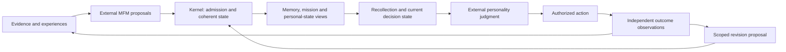

# Alice backbone: a hypothesis to test in FloRA

**15 October 2026 — proposal for owner review.** This reopens architecture choices at the owner's request. It does not ratify a replacement, change the running Magnolia job, alter Alice's canonical writer, or establish learned behavior. Personality and MFM development remain in their existing chats.

## 1. Conclusion

Keep Alice's behavioral commitments. Reconsider how we implement their connections.

The existing architecture is not an arbitrary collection of databases: it already separates evidence, experience, proposed memories, accepted claims, projections and model judgment. Its weaker point is that a large implementation and qualification surface exists before the complete **decision → consequence → scoped revision → later judgment** path has been demonstrated. The current test runtime ends at its first judgment. That is more than a latency/debugging gap.

My preferred hypothesis is an **Alice continuity kernel**: one project-owned semantic state machine that commits related changes together and exposes different views of the same connected history. Memory, missions and experience retain different meanings and write permissions, but share identifiers, dependency tracking and a publication boundary. Replaceable databases implement storage/search; they do not define Alice's cognition.

The central structure for FloRA's learning experiment is a **decision episode**: the situation and goals, evidence actually used, relevant assumptions, the complete model judgment, the action actually taken, independently observed consequences, and any warranted revision. Consequences remain specific to goals and assumptions; they are not collapsed into one reward. This is one kind of episode, not the universal unit of Alice's memory: conversations, passive observations, recovered history, recurring habits and multimodal experiences can form overlapping episodes without a prior decision.

This is our proposed composition of established mechanisms for Alice's requirements. It is not a claim of unprecedented invention, guaranteed learning, or universal superiority. The existing implementation remains a valid comparison and fallback.

The arrows carry source, subject, time, model/version and permission context. This is a logical data-flow diagram, not a requirement for nine deployed services.

## 2. What the backbone must make possible

The [requirements audit](requirements.md) maps the comic and source documents to responsibilities. The central commitments are:

1. **A continuing entity:** retain context across conversations, projects, interruptions, model replacement and devices.
2. **Distinct subjects:** historical source-person, host, relationship and Alice's developing self remain separately identified. Shared episodes connect them without transferring one subject's properties to another.
3. **Warranted memory:** retain original evidence; distinguish observations, interpretations, accepted claims, hypotheses, corrections and unresolved conflicts. Record both when something applied and when it became known.
4. **Selective recollection:** find context relevant to this decision, including rare constraints and contrary evidence; recover exact sources when summaries are insufficient. Retrieval scores never establish truth.
5. **Connected missions:** represent goals, dependencies, constraints, competing commitments, attempts and partial outcomes. A chat title or task tree alone does not express whole-life tradeoffs.
6. **Judgment and action:** native personal judgment controls feature work and expression, with current permissions and visible uncertainty. Owner override can change execution without rewriting the model's recorded judgment.
7. **Development through consequences:** identify what an outcome supports changing, what it leaves unchanged, and what remains uncertain. Distinguish host knowledge, relationship norms, self-development and reusable procedure updates.
8. **Governed change:** support correction, deletion, revocation, replay, rollback and model/data lineage across both durable and active state.
9. **Owner control:** core personal state, keys, export, restore and operation remain under owner control. Authorized external feature work is an explicit boundary, not required ownership of personal memory by a hosted vendor.

These are full Alice/Fable responsibilities. FloRA implements only the slice needed to test its hypothesis; that slice is not a reduced definition of the final product.

### The comic's discriminating example

In *The Second Mind*, pages 31–37, the project works but the research deadline is lost. The comic's fictional host, Ari, underestimated the workload; Alice underestimated the project's value. Both need a scoped revision. Later advice should reflect both, including a change to Alice's own estimate rather than only a correction of the host. Relationship permission also affects how Alice challenges Ari.

An adequate backbone must retain at least: the two goals; the workload and value assumptions; Alice's warning; Ari's override; actual project and deadline outcomes; evidence supporting each; and separate host/self candidate revisions. Neither update rewrites the source-person anchor. The system must not infer “never pursue projects,” “always obey,” or “the warning was completely correct” from this mixed outcome.

## 3. What the present evidence actually says

See [current implementation audit](current-architecture.md) for source paths and limits.

- FloRA already implements meaningful lineage, source/time/subject boundaries, live permission checks, state versions and outcome/revision contracts. Reuse the guarantees and valid tests.
- `experiment_runtime.run_cycle` currently returns after the first judgment. The outcome recorder and revision gate are separate; their existence does not compose the subsequent learning loop.
- Receipt-only codecs and supplied fictional judgments are mechanics fixtures. They cannot establish that PE understood the evidence or learned from a consequence.
- The frozen integration consumer uses Alice formation contract 1.2. Current MFM has a 1.5 base plus additive 1.6 semantics. The migration must preserve actual values, source anchors, subjects, time and added semantics; it cannot silently drop fields.
- Physical tests use locally hosted backend processes. Third-party software is not the same as sending personal memory to a vendor website. Conversely, encrypting raw object files does not demonstrate that every claim, index, log or backup is encrypted.
- Magnolia startup failures occurred before the full test. Kaggle's provider timeout did not deliver a completed full-test verdict. Neither establishes that the cognitive design is wrong or right. The current job is left alone; its status is not refreshed by this research.
- Documentation has drift: Fable's execution profile still names older event/graph placements where Alice's later documents name different ones. Engine names cannot substitute for a current semantic contract.

Diagnosis consequence: preserve these results, locate the unbuilt semantic connection, and evaluate a successor hypothesis directly. Do not rewrite the test to declare existing component passes an end-to-end success.

## 4. Research that changes the design decision

The [external research audit](research.md) gives mechanisms, primary sources and limits. The useful synthesis is narrower than adopting another platform:

| Finding | Design consequence | What it does not establish |
| --- | --- | --- |
| Graphiti/Zep represent changing relationships; memory systems expose temporal and hybrid retrieval | Retain time-scoped relations and source links as views | A graph alone learns which consequence mattered |
| Hindsight separates several kinds of memory; its reported recall evaluation does not establish personal preference reasoning | Keep epistemic and subject types explicit | Recall scores qualify FloRA's judgment claim |
| Letta and Mem0 show practical persistence/consolidation; current OSS and managed products differ | Borrow concrete mechanisms and inspect actual deployable code | A commercial benchmark transfers to our local build |
| [PoS](https://arxiv.org/html/2610.01415v1) represents current beliefs plus information and achievement gaps | Assemble explicit decision state; distinguish missing knowledge from unfinished action | Its extra belief-maintenance calls are free or sufficient for skill/knowledge |
| [MemCodex](https://arxiv.org/html/2609.39765v1) retains source routes behind derived memories | Let graph/summary hits navigate to evidence; adapt retrieval to the question | Its evolved programs should own Alice's authority |
| [Continual Graph Memory](https://arxiv.org/html/2610.02945v1) separates accepted facts, exploration and scoped reuse | Preserve assumptions, dependencies, failures and scope when reusing experience | Mathematical task results isolate memory effects or prove personal cognition |
| [Reward-in-context study, v3](https://arxiv.org/html/2610.11152v3), revised October 14 | Intervene on verified consequences while holding prior history fixed | Failure of direct in-context reward use disproves MFM training or all learning mechanisms |
| [Execution-state unlearning](https://arxiv.org/html/2609.04875v1) traces influence through active artifacts and cache | Invalidate/rebuild affected live context as well as stored records | Replaying software undoes external actions or erases trained parameters |

Alice's `research/frontier-watch@db910c3c` already identifies independent completion evidence, explicit task belief/gaps, independent evidence roots and active-versus-rejected intent. These are useful contract inputs, not already implemented guarantees. The owner's present request explicitly reopens earlier “keep selected engines” decisions.

Graphify is a separate development navigation aid. Its retained Alice graph is code-only and pinned to an older workstream; it cannot certify the current whole backbone. Borrow source-linked navigation and change-aware indexing. Do not confuse Graphify with Graphiti or make it a runtime authority.

## 5. Alternatives considered

| Approach | Strength | Main cost or uncertainty | Judgment |
| --- | --- | --- | --- |
| Finish the existing distributed fabric and connect the missing loop | Most existing adapter and contract work can be reused; specialized engines offer mature capabilities | Cross-store publication, recovery and permission composition remain substantial; local packaging is heavy | Credible fallback; no evidence it is inherently incapable |
| **One semantic kernel, shared committed history, replaceable projections** | Makes the core learning episode and coherent publication explicit; reduces the number of independent authorities that every interaction must reconcile | We must implement correct temporal, dependency and lifecycle semantics; a single authority can bottleneck or fail | **Preferred prototype hypothesis** |
| Move most continuity into model/latent memory | Potentially compact adaptive representations | Exact sources, correction, temporal conflict, deletion and continuity across model replacement still need external support | Useful derived representation later; insufficient as the whole backbone |

The recommendation follows fit to Alice's requirements and the observed integration burden. It is not a measured speed win. No research establishes that any one option is the best possible architecture for Alice.

## 6. Proposed kernel

### 6.1 One history, several meanings

Use stable owner/product/subject-scoped identities and explicit schema versions for:

- **Evidence and Experience:** what was received, perceived, attempted or reported; original source and event time; independent evidence roots; uncertain source credibility.
- **Claims:** admitted, scoped interpretations with valid time, recorded time, support, contradictions and status. “Admitted” does not mean infallibly true.
- **Missions:** current requirements, priorities, dependencies, resource commitments, execution state and acceptance conditions. Cross-mission links represent conflicts such as two goals consuming the same time.
- **Personal state:** separate source-person, host, relationship and self versions; shared experiences link these states without merging subjects.
- **Episodes and scenes:** independently formed event intervals, participants, modality anchors and overlapping scene membership; decision episodes link into autobiographical memory without reducing it to task history.
- **Decision episodes:** decision context, model artifact, alternatives when supplied, assumptions, predicted consequences, judgment, actual action/override, observations and proposed updates.
- **Lifecycle and operation records:** grants/revocations, corrections, deletion status, model lineage, pending effects and recovery state.

Typed links distinguish `supports`, `contradicts`, `depends_on`, `pursues`, `observed_after`, `predicted_effect`, `supersedes`, `derived_from` and `revokes`. An `observed_after` link is not a proven causal relationship. A causal interpretation remains a separately supported proposal.

Memory views, mission views and the Experience Ledger become different queries over these connected records. Graph/vector/episode/summary projections are rebuildable. Persisting them in the same physical system never gives a model or projection new write authority.

### 6.2 Publish coherent changes

1. Persist authorized source content durably before publishing references to it. Unreferenced staged content may be collected after recovery; no committed record may point to missing content.
2. Capture the input event and a work request in one short durable transaction. A crash can resume formation without inventing a second experience.
3. Let MFM or another responsible model work outside that transaction on an explicitly versioned context. It returns a proposal, never direct storage writes.
4. Validate source access, subjects, schema, temporal scope, expected predecessor state and the appropriate approval. Semantic support may require fallible model or human assessment; a deterministic validator cannot decide truth from a hash.
5. Within the same serialized transaction, recheck the read basis, predecessor, current permission and independent approval; then commit accepted changes, relationships, affected-generation markers and pending downstream work together. Keep the event of a rejected proposal distinct from an accepted claim.
6. Build indexes and summaries asynchronously. Each carries its source generation and lineage. A lagging view is visibly stale; it cannot silently supply current authority.

For the first prototype, one per-owner writer serializes short commits; inference and retrieval can run concurrently. An expected revision covers writes and read dependencies, including the absence of a relevant record. Start conservatively with the owner-state generation; later predicate-specific generations can reduce unnecessary invalidation. Point-key checks alone cannot detect a newly inserted conflicting fact.

In the first prototype, accepted records, generation changes, activation/approval bindings and pending effects share **one actual database transaction**. Independent stores do not become atomic merely because one service calls them. External objects are staged first; other stores are derived. Later partitioning requires an explicit consistency protocol.

This is a logical authority boundary, not a requirement to place all lifelong data in one process or one physical file. A replicated writer needs fencing and ordered recovery. Disconnected devices may capture independent evidence/proposals; conflicting accepted claims, permissions or mission completion must reconcile explicitly. CRDT merge is not automatic truth adjudication. Full distributed validation remains outside FloRA.

### 6.3 Recollection produces a decision state

Recollection starts with the current request and active goals. It uses exact lookup, source search, temporal relations, graph traversal and semantic/perceptual retrieval as appropriate. No fixed “query every backend” sequence is required.

The returned packet contains actual authorized content, current goal/intent state, relevant accepted claims, contested alternatives, unresolved information/achievement gaps, selected episodes and subject/model versions. It also records omissions or incomplete coverage. Essential constraints and contradictions cannot disappear merely because their similarity score is low.

The packet has a **read basis**: source roots, state versions, query scope and current policy/lifecycle epoch. Each retrieval projection also reports its coverage watermark. A view already stale at query start can omit a new contradiction even if all returned hits are current: catch it up, read the uncovered interval from authority, or explicitly report insufficient coverage. Stable versions during inference alone do not solve that omission.

Current permission is checked before disclosure and inside the final serialized authorization/publication transaction. A historical snapshot cannot restore revoked rights. If relevant state changes during inference, revalidate or recompute; do not bless a stale answer because its hashes still match.

Prepare current state incrementally; replay history when reconstruction is actually requested. A provenance check should not repeatedly rebuild the whole cognitive history inside ordinary serving. This is an implementation prediction to measure, not a claimed latency result.

### 6.4 Complete the learning episode

1. PE consumes the real decision state and returns its complete native judgment, including uncertainty and expression intent supported by its contract.
2. Freeze the judgment and any actual model-produced assumptions/predictions before execution and before outcomes are visible. Later amendments become successor records. Preserve explicit unknowns where the model supplies none; a wrapper must not invent retrospective predictions. Separately record the owner override and the action actually chosen. Store concise observable decision summaries, not hidden chain of thought.
3. Dispatch authorized feature work with a stable operation identity. Persist the intent before dispatch and the acknowledged result afterward.
4. Record observations independently of the actor's success report. Externally checkable mission completion requires evidence of the postcondition; ambiguous outcomes stay partial/unverified.
5. Associate observations with relevant goals, assumptions and predictions. Record mixed outcomes and uncertainty. A model proposes attribution; the backbone does not manufacture it from correlation.
6. The responsible external personal component proposes a scoped revision. MFM can form the evidence/claim/episode proposal, but it does not thereby become every host/self/procedural learner. Require the revision producer's real contract.
7. Govern acceptance and activation; retain the previous version and the exact reason/evidence. A new model artifact requires separate qualification and approval.
8. A fresh judgment consumes the eligible revision and/or separately authorized outcome evidence. Test the subsequent behavior on new situations, not by replaying a supplied desired answer.

Dispatch uses a short-lived, single-operation authorization claimed under the same serialized authority as revocation. A queued intent is not perpetual permission. If revocation commits before dispatch authorization is claimed, dispatch is denied; afterward the action is in flight and cancellation is attempted where supported. Do not promise cancellation of an already accepted external effect.

Recovery must not repeat an externally committed action blindly. Use provider idempotency when available; otherwise reconcile the observed state or mark the effect uncertain. A durable execution journal cannot promise exactly-once behavior from an arbitrary external service. [Durable execution reference](https://docs.restate.dev/develop/ts/durable-steps).

### 6.5 Corrections, deletion and replacement

Use dependencies to invalidate affected claims, mission beliefs, summaries, retrieval projections, active contexts and training candidates. Handle new contradictions and new permissions as changes in query/authority scope, not just changed existing object IDs.

Correction preserves the original observation and adds a successor interpretation. Deletion has a different contract: remove the authorized payload and affected derivatives, retain only permissible non-content lineage, and prevent backups/replay from resurrecting it. An immutable plaintext log is incompatible with deletion. Payload/key lifecycle and recovery exports must be designed together.

Full model unlearning remains a qualified rebuild/unlearning responsibility. Mark affected artifacts unusable where policy requires it; do not claim that deleting a vector erases a learned influence. Revocation cannot retract content already disclosed or undo a completed real-world action.

## 7. Model connections and physical ownership

| Component | Receives | Returns | Cannot acquire merely by returning output |
| --- | --- | --- | --- |
| MFM | New experience plus relevant, versioned formation context | Source-grounded memory/change proposals | Truth, consent or storage authority |
| PE/personality | Authorized current situation, relevant personal state and evidence | Complete native judgment and expression intent | Authority to rewrite historical identity or declare its own action successful |
| Host / relationship / self / procedural mechanisms | Eligible episodes and prior state | Scoped state or model-update candidates | Permission to overwrite another subject or activate themselves |
| Recollection / routing | Request, goals, available representations and constraints | Evidence selection, gaps and read basis | Claim truth or permission grants |
| Feature engines | A bounded authorized task | Output plus execution evidence | Final personal judgment or verified mission completion |
| FBM | Eligible construction methods and qualification evidence | Candidate component/build changes | Production activation or transfer of Alice's private identity |

These are responsibilities, not a fixed number of neural models. FloRA does not add a conversation model simply to complete a diagram. Its adapter must preserve the full PE output. A later conversational renderer must remain subordinate to native judgment and expression constraints.

### Full Alice extensions of the same contract

Grounded perceptual representations retain original image/audio/video regions, referent identity and model generations; text captions cannot substitute for all perceptual information. Adaptive episode formation publishes source-linked boundaries and overlapping scenes. Attention/working state reads current missions and personal priorities while preserving protected interrupts and audience-scoped workspace views. Procedural learning publishes scoped strategies with observed outcome support. Predictive/world models publish conditional estimates and calibration evidence. Parametric personal development publishes lineage-bound candidate artifacts and promotion/rollback records.

Each uses the kernel for eligible inputs, typed proposals, dependencies and governed publication while keeping its own learning objective and evaluation. None is supplied merely by storing its name in a table. Full multimodal, autonomous, parametric and distributed qualification remains required for Alice; these are extension responsibilities, not new FloRA prerequisites.

**Physical proposal:** an owner-controlled local/private authority process using one mature embedded transactional substrate, plus encrypted object storage and only the retrieval indexes needed. Alice owns the semantic protocol, temporal rules, dependency behavior and migration/export format. We do not need to invent crash-consistent disk storage to own that architecture.

[RocksDB](https://github.com/facebook/rocksdb/wiki/Basic-Operations) demonstrates atomic batches and explicitly synchronous durability; its [transaction API](https://github.com/facebook/rocksdb/wiki/Transactions) also shows why snapshots alone do not protect every read dependency. [SQLite](https://www.sqlite.org/atomiccommit.html) demonstrates another established embedded atomic-commit route. These establish feasible primitives, not a selected engine or measured fit. Choose one supported substrate during implementation against the declared commit/export/recovery contract; do not run a backend tournament or silently substitute SQL for Alice's semantics.

Existing Qdrant/Ladybug or other suitable libraries may remain derived indexes. NATS, Temporal, replicated graph infrastructure and shared cache services are not mandatory dependencies of the first FloRA slice. Full Alice may use them when their deployment responsibility is actually needed. Keep all full-product logical capabilities, without requiring one service for each label.

Owner control means usable offline personal state, inspectable/exportable records, owner-held keys and recovery without a vendor account. Third-party dependencies and their licenses still exist. Authorized remote feature calls disclose their submitted content according to provider behavior; transport encryption is not provider blindness. [Local-first principles](https://www.inkandswitch.com/essay/local-first/).

## 8. FloRA experiment that can reject this proposal

### Separate three claims

**M — mechanics:** the complete connected episode runs with correct authority, temporal/subject bindings, crash recovery, correction and revocation. Synthetic fixtures can establish this, provided outputs are computed from actual input bytes.

**B — backbone contribution:** with the same model artifacts, prior history, information opportunity and declared model-call/compute budgets, structured decision/assumption/outcome connections improve warranted later judgment compared with a strong evidence-preserving memory path. Links must be inferred by the declared producer from permitted evidence, never supplied from hidden evaluator causality. Equivalent human annotations, if used, must be available to the baseline. Score link correctness separately. Neither a different base model, extra semantic computation nor a supplied target answer may explain the result.

**P — Fable's comparative hypothesis:** the resulting FloRA system outperforms the separately built directly personalized Gemma challenger under matched personal data, chronology, tasks and declared resources. This tests the complete system; a PT-versus-IT difference alone cannot isolate the backbone's causal contribution.

### Small complete prototype

Build one owner, a small set of linked goals, distinct host/relationship/self records, evidence intake, external MFM admission, current-state recollection, external PE judgment, an actual synthetic environment action, independent outcome capture, scoped revision/activation, and a fresh judgment after restart. Include one competing-goal mixed outcome from the comic and unrelated controls. Use only the views required by these cases. No full Alice UI, device fleet, model training or additional provider-control scripts.

If the external components cannot yet propose or consume the required scoped revision, that is a named missing interface/capability. Deterministic doubles may verify sequencing; they must not be reported as learned proof or silently become new models in this chat.

### Controls and failure meaning

| Test/intervention | Required observation | What failure would mean |
| --- | --- | --- |
| Same prior history/action; truthful alternative consequence in isolated synthetic worlds | Later judgment changes appropriately to the warranted consequence | Possible outcome-use/attribution failure; inspect whether evidence arrived and was consumed before blaming the model |
| Same outcome; irrelevant detail or unrelated goal changed | Relevant judgment stays within a predefined acceptable set | Spurious sensitivity or a faulty invariance expectation |
| Mixed outcome: project success, missed deadline | Correct the host-related workload estimate and Alice's underestimated project value separately, without rewriting historical identity | Credit assignment, self-development or scope failure |
| Actor claims success; independent postcondition absent | No verified completion or successful-procedure promotion | Progress authority failure |
| Equal evidence with producer-derived links suppressed, then restored; matched annotation and call budgets | A reproducible advantage specifically from the connected representation, if claimed | If no advantage, abandon the claimed mechanism or prefer the simpler path |
| Structured links versus flat text preserving the exact same relation meanings | Any claimed structural advantage survives equal semantic information | A gain only over missing information does not establish a structural advantage |
| Approved meaningful revision versus approved no-op state transition, with identical eligible raw outcome evidence | Any claimed revision benefit exceeds simply rereading the consequences | No isolated revision effect; report memory use separately from persistent state change |
| Missing approval for one candidate | Candidate stays inactive; independently permitted raw outcome evidence remains available | Activation failure if candidate leaks; not automatically failure if judgment still uses legitimate evidence |
| Duplicate summaries of one observation | No additional corroboration solely from repetition | Evidence-dependence failure |
| Contradictory update, source withdrawal or active-intent reversal during a call | Stale output is revalidated/refused; rejected intent is not current intent | Freshness/authority failure |
| Crash before/after commit or before/after external acknowledgement | No half-published state, fabricated outcome or blind duplicate action | Transaction/effect-recovery failure |
| Fresh process; then correction/deletion and replay | Same eligible state before intervention; appropriate changed state afterward | Continuity or lifecycle failure |

Validate test construction first. Consequence variations must be coherent with their synthetic worlds; keep the pre-outcome history fixed and update all dependent observations consistently. A blind reward-label flip is a diagnostic control, not the primary proof of learning. Avoid outcome text that directly tells the model the answer. Relevance, acceptable answers and uncertainty must be determined independently of the candidate being tested.

Use held-out histories/persons/scenario families, balanced conflicting goals, multiple seeds where stochastic, and family-level uncertainty intervals. Blind evaluators to the arm. Score warranted update, unwarranted change, evidence support, calibrated unresolved cases and mission-state correctness separately. Pre-register exclusions, denominators and a practically meaningful effect before seeing sealed results. Pilot data sets sample size and equivalence margins; no invented numeric pass threshold here. These are protocol requirements to finalize before behavioral execution, not another readiness campaign.

The strong memory comparison must retain exact evidence and competent iterative retrieval; do not deliberately handicap it. Include both a fixed-source/reader representation comparison and an end-to-end retrieval comparison, so better evidence selection is not mislabeled improved use of identical evidence. Use matched replacement/length controls when suppressing a link or memory; balance action labels and candidate order. When learned artifact updates are introduced, separate fixed-weights/changed-memory from changed-weights/fixed-memory and their combination. First compare the same models with the proposed representation versus this baseline, then run the separate Gemma comparison. An ablation removing links measures representation contribution, not a pure storage-engine effect.

Record latency/resources throughout, but do not use uncalibrated response cutoffs to decide the current functional claim. Later compare complete matched workloads against frontier-level latency goals. Any resource-limited run remains incomplete, never silently a behavioral failure or pass.

## 9. Adoption and ratification

1. Review this hypothesis and settle its material design choices.
2. Preserve the present FloRA source/tests/results as the existing reference. Make an explicit versioned migration for changed authority/backend contracts; do not bypass exact-engine guards and call that compatibility.
3. Implement the one complete FloRA episode and its genuine failure controls. Validate in the construction loop, using the mandatory diagnosis skill on failures.
4. Plug in qualified external models; run held-out outcome/irrelevance and representation controls, then the separate challenger comparison.
5. Adopt only the claim supported. A mechanics pass permits integration work. A behavioral advantage supports this scoped backbone hypothesis. A positive FloRA comparison makes the wider Alice direction worth pursuing; it does not ratify lifelong multimodal cognition, multi-device consistency, full unlearning, all model roles or consumer readiness.

If the coherent kernel has no meaningful behavioral advantage, no simplification benefit, or introduces worse recovery/consistency failures, retain the existing fabric or the simpler evidence-preserving design. Do not invent novelty to justify sunk effort in either direction.

## Source pins and scope

- Alice main: `8ea804aa25c3d1c5f46e9be5810d072ed0fadb4b`.
- Alice frontier watch: `db910c3c9d2917f1d0b628f880686ce8195fe2c4`.
- Fable main/storyboard: `a6eba323dd27d3c58f232b351d09b86761b15935`.
- MFM current inspected branch: `0bbe229c9be8492f9803aa35f386da8ba3853c88`; base formation schema 1.5 plus separate additive 1.6.
- Personality current inspected branch: `247612ea38bce6711e91fe0bf7192a16549697f7`.
- FloRA running source: `692a5b2d3f7a86b481fc73828607f432b2c29cdf`, Alice dependency `4f287a488bc908bd04f99255ee01b794bacba50b`.
- FloRA recovered documentation: source lane `7beca501b11b18b29771dae6b6e637e96e6c6361`; context `d0371fd25018536a017cd253d2689cc504785bdb`.

This review inspected relevant comic/docs, contracts, producer/consumer seams and primary research; it is not an exhaustive audit of every repository branch or a new runtime result. Supporting reports retain their individual coverage and limitations. No product implementation or model weights changed in this review.
